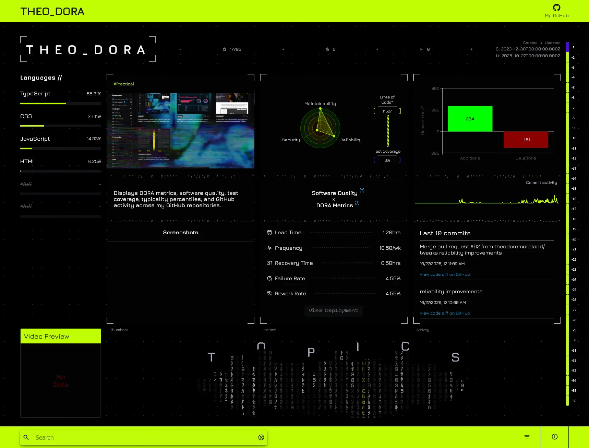

# THEO_DORA (Work in progress)



## Table of contents

- [Overview](#overview)
  - [Technologies Used](#technologies-used)
- [DORA Metrics](#dora-metrics)
- [Software quality measures](#software-quality-measures)
- [Serverless infrastructure](#serverless-infrastructure)

## Overview

**This is a work in progress.**

This project encourages continuous improvement of software quality and delivery. It features a dashboard that calculates and displays DORA metrics, software quality measures, test coverage, typicality percentiles, and GitHub activity for my GitHub repositories.

### Technologies Used

- React
- TypeScript
- JavaScript
- HTML
- CSS
- Tanstack React Query
- MUI X Charts
- GitHub Rest API
- GitHub GraphQL
- GitHub Actions
- SonarQube Cloud
- Vite
- Axios
- Docker
- AWS
- AWS Lambda
- AWS DynamoDB
- AWS API Gateway
- AWS SAM

## DORA Metrics

DORA metrics measure the effectiveness of a project's software delivery. Effectiveness can be broken down into two categories: Throughput and Instability.

[DORA Metrics](https://dora.dev/guides/dora-metrics/)

## Software quality measures

High quality code contributes to software that is secure, reliable, and maintainable. SonarQube's software qualities help asses the overall health of your code. These three aspects - security, reliability, and maintainability - are called software qualities in SonarQube and they contribute to the long-term value of your software:

[Software quality measures](https://docs.sonarsource.com/sonarqube-cloud/standards/managing-rules/rules#software-qualities)

## Serverless infrastructure

This project contains source code and supporting files for serverless infrastructure that can be deployed with the AWS Serverless Application Model (AWS SAM) command line interface (CLI).

For an introduction to the AWS SAM specification, the AWS SAM CLI, and serverless application concepts, see the [AWS SAM Developer Guide](https://docs.aws.amazon.com/serverless-application-model/latest/developerguide/what-is-sam.html).

### SAM template notes

Regarding linting errors in VS Code and template.yml files, specifically in reference to !Ref, !Sub, etc...

https://docs.aws.amazon.com/AWSCloudFormation/latest/TemplateReference/intrinsic-function-reference.html

Add to Workplace settings to remove invalid linting errors for the following values:

```json
{
  "yaml.customTags": [
    "!Base64 scalar",
    "!Cidr scalar",
    "!And sequence",
    "!Equals sequence",
    "!If sequence",
    "!Not sequence",
    "!Or sequence",
    "!Condition scalar",
    "!FindInMap sequence",
    "!GetAtt scalar",
    "!GetAtt sequence",
    "!GetAZs scalar",
    "!ImportValue scalar",
    "!Join sequence",
    "!Select sequence",
    "!Split sequence",
    "!Sub scalar",
    "!Transform mapping",
    "!Ref scalar"
  ]
}
```
